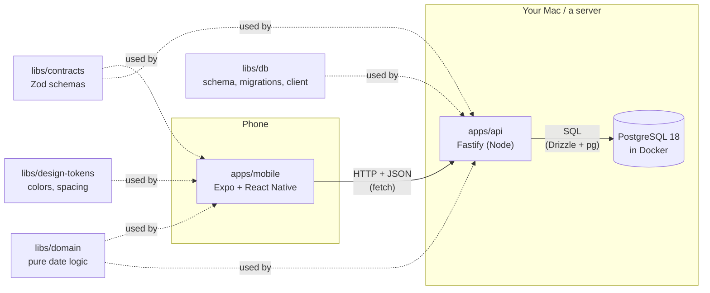
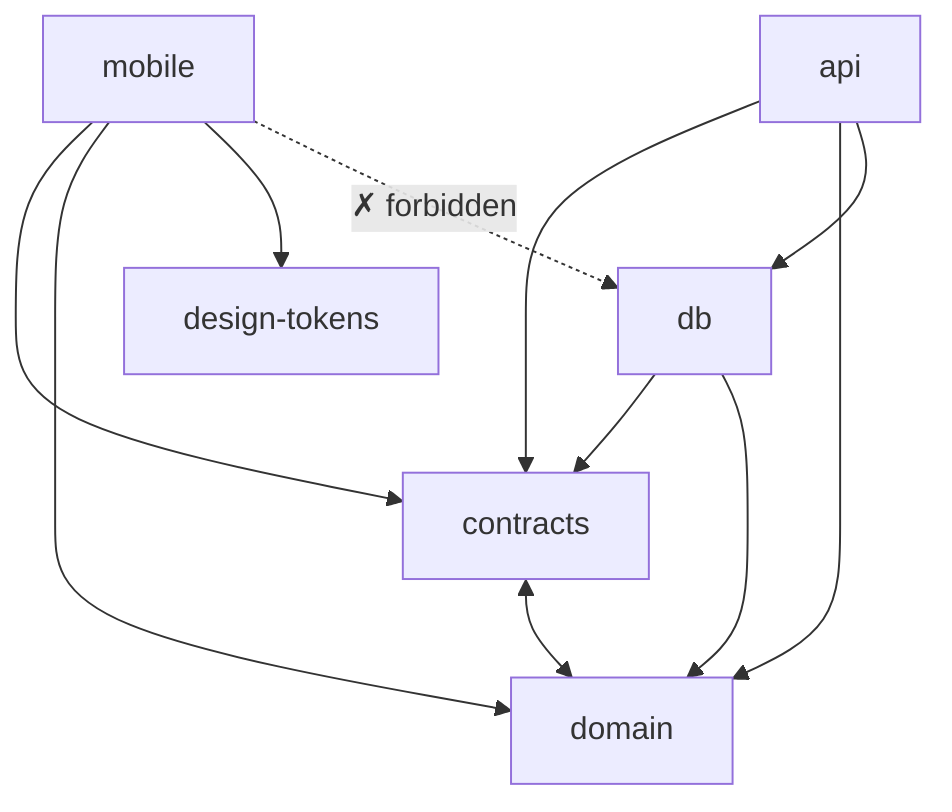
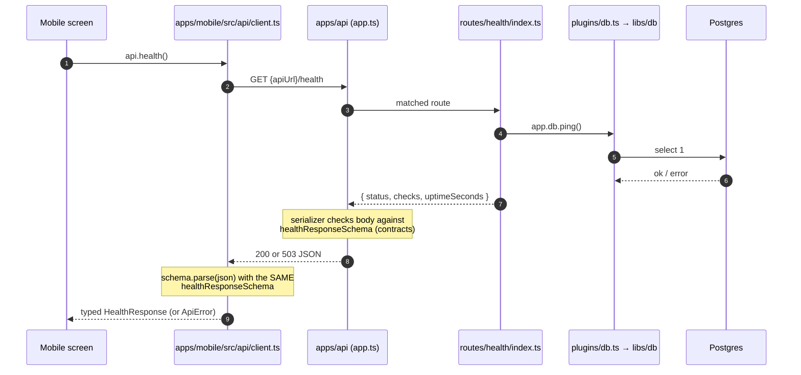
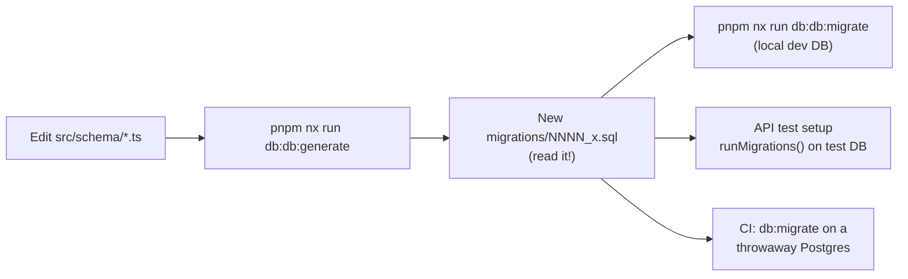
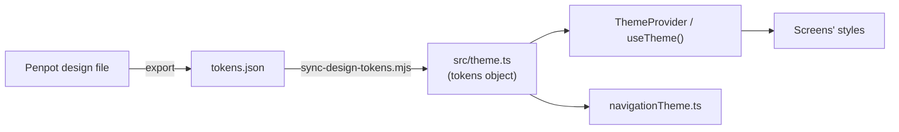
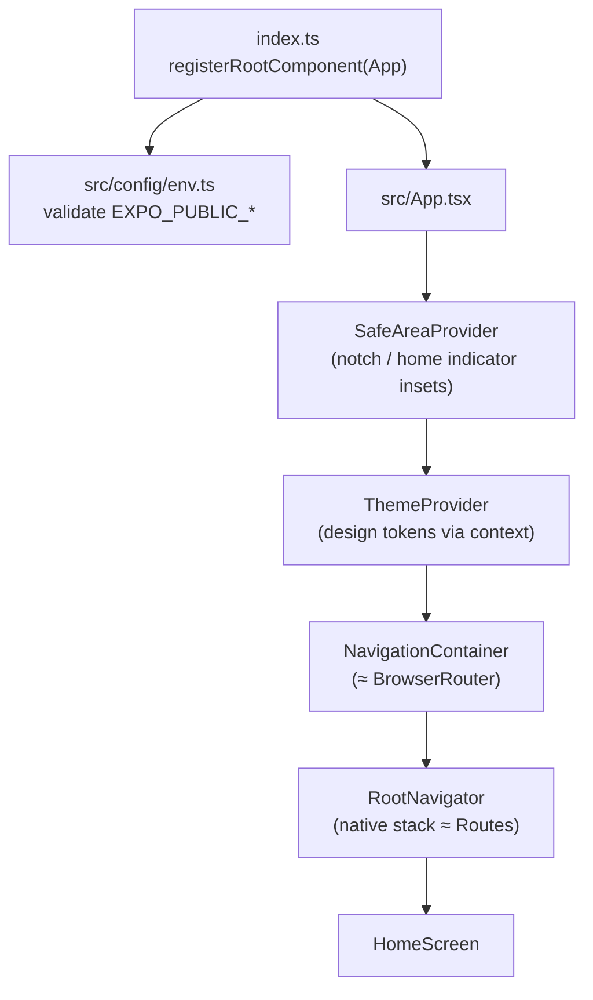
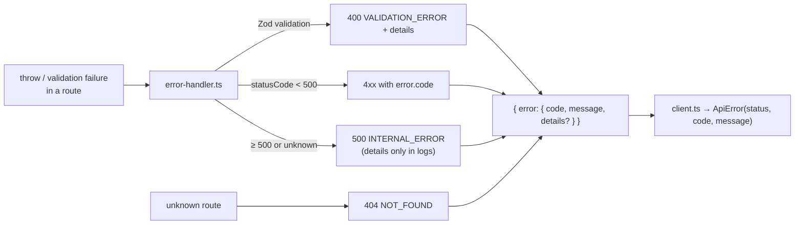
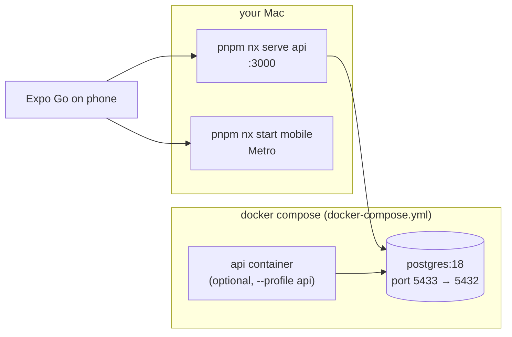
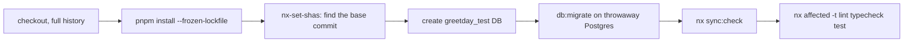
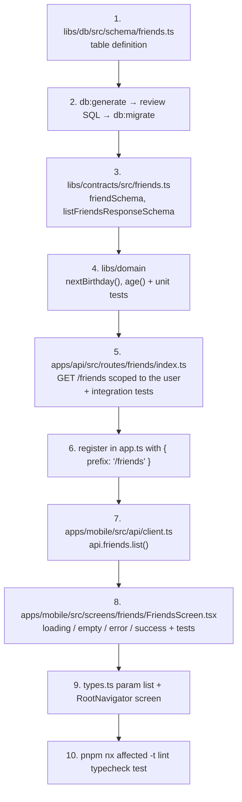

# Onboarding: how GreetDay is built

A guided tour of the codebase for someone who knows React on the web and is new to the backend
(Node, SQL, Docker) and to React Native. Read it top to bottom once; afterwards use it as a map.

- **What the product is:** [ba-brief §1–2](product/ba-brief.md). In one line: a phone app that
  reminds you of friends' birthdays and helps you send a greeting through Telegram.
- **How to install and run things:** [README](../README.md). This page explains _why_ things are
  where they are; the README tells you _what to type_.
- **Rules for code changes:** [CLAUDE.md](../CLAUDE.md) and the nested `CLAUDE.md` in each app/lib.

> **Where the project is today.** The repo is the _foundation_: tooling, CI, Docker, environments,
> design tokens, and one endpoint (`GET /health`) wired end to end. `libs/domain` and the database
> schema are still empty, and the app has a single placeholder screen. That is good news for
> learning: every file that exists is short, and each one shows a pattern that the real features
> will copy.

---

## Contents

1. [The big picture](#1-the-big-picture)
2. [The monorepo: one repo, six projects](#2-the-monorepo-one-repo-six-projects)
3. [Who may import whom (module boundaries)](#3-who-may-import-whom-module-boundaries)
4. [Follow one request end to end: `GET /health`](#4-follow-one-request-end-to-end-get-health)
5. [Project tour, file by file](#5-project-tour-file-by-file)
6. [Cross-cutting topics](#6-cross-cutting-topics)
7. [Infrastructure: Docker, Postgres and CI](#7-infrastructure-docker-postgres-and-ci)
8. [Root config files](#8-root-config-files)
9. [The AI layer (`.claude/`)](#9-the-ai-layer-claude)
10. [How a real feature will flow through the code](#10-how-a-real-feature-will-flow-through-the-code)
11. [Your first hour: hands-on exercises](#11-your-first-hour-hands-on-exercises)
12. [Glossary: web ↔ this repo](#12-glossary-web--this-repo)

---

## 1. The big picture

GreetDay is three running pieces plus shared code:

If you've built a Next.js app, this is the same split, just pulled apart:

| Web (Next.js)                          | GreetDay                                                   |
| -------------------------------------- | ---------------------------------------------------------- |
| Client components in the browser       | `apps/mobile`, running on the phone                        |
| Route handlers / server actions        | `apps/api`, a separate Node process                        |
| Prisma (or similar) + a database       | `libs/db` (Drizzle) + Postgres in Docker                   |
| Types shared between client and server | `libs/contracts` (Zod schemas, so also checked at runtime) |
| Tailwind config / CSS variables        | `libs/design-tokens`                                       |

Why the API is separate instead of living inside the app: a phone app is a static bundle installed
on someone's device. It can't hold database passwords or run SQL safely, so anything private lives
behind an HTTP API that you control.

---

## 2. The monorepo: one repo, six projects

All code lives in one Git repo managed by **Nx** with **pnpm workspaces**. Think of pnpm workspaces
as "several `package.json` projects in one repo that can import each other", and Nx as the task
runner on top: it knows which project depends on which, runs `lint`/`typecheck`/`test` per project,
caches results, and with `nx affected` only runs what your change could have broken. Why Nx and not
two repos: [ADR 0001](decisions/0001-nx-monorepo-and-claude-code-layout.md).

| Path                 | Nx name         | Kind | Tags                       | One-liner                                                   |
| -------------------- | --------------- | ---- | -------------------------- | ----------------------------------------------------------- |
| `apps/mobile`        | `mobile`        | app  | `scope:mobile`, `type:app` | The Expo app users install                                  |
| `apps/api`           | `api`           | app  | `scope:api`, `type:app`    | The HTTP API                                                |
| `libs/contracts`     | `contracts`     | lib  | `scope:shared`             | Request/response shapes (Zod) shared by app and API         |
| `libs/domain`        | `domain`        | lib  | `scope:shared`             | Pure business rules: next birthday, age, Feb 29 (empty yet) |
| `libs/db`            | `db`            | lib  | `scope:db`                 | Database schema, migrations, connection helper              |
| `libs/design-tokens` | `design-tokens` | lib  | `scope:ui`                 | Colors/spacing/fonts from Penpot, as a typed TS object      |

### How a project is declared

There are no `project.json` files. Each project's `package.json` has an `"nx"` block with its name,
tags and any custom targets; everything else is **inferred** by Nx plugins listed in
[`nx.json`](../nx.json):

| Plugin in `nx.json` | Adds the target                 | Because the project has… |
| ------------------- | ------------------------------- | ------------------------ |
| `@nx/js/typescript` | `typecheck`                     | a `tsconfig.json`        |
| `@nx/eslint/plugin` | `lint`                          | an `eslint.config.mjs`   |
| `@nx/vitest`        | `test` (libs, api)              | a `vitest.config.mts`    |
| `@nx/jest/plugin`   | `test` (mobile)                 | a `jest.config.cts`      |
| `@nx/expo/plugin`   | `start`, `run-ios`, `export`, … | an Expo `app.json`       |

Run `pnpm nx show project api` to see every target a project ends up with.

### How a lib is consumed (no build step)

Libraries are **never compiled on their own**. Look at
[`libs/contracts/package.json`](../libs/contracts/package.json): `main`, `types` and `exports` all
point straight at `./src/index.ts`. An app lists the lib as `"@greetday/contracts": "workspace:*"`,
pnpm symlinks it into `node_modules`, and whoever builds the app compiles the lib's TypeScript
along with its own:

- **API:** esbuild bundles `apps/api/src/main.ts` and inlines the libs (npm packages stay external,
  which is why `pg` and `drizzle-orm` appear in `apps/api/package.json` too).
- **Mobile:** Metro (React Native's bundler, the Vite of this world) resolves the libs through
  `withNxMetro` in [`apps/mobile/metro.config.js`](../apps/mobile/metro.config.js).
- **Tests and typecheck:** Vitest/Jest/tsc read the `.ts` sources directly.

`moduleResolution: "bundler"` in [`tsconfig.base.json`](../tsconfig.base.json) is what lets
TypeScript follow those `exports` to `.ts` files, the same way Vite does.

---

## 3. Who may import whom (module boundaries)

The rule is enforced by `@nx/enforce-module-boundaries` in
[`eslint.config.mjs`](../eslint.config.mjs) using the tags above. Break it and `lint` fails.

Why each rule exists:

- **mobile never imports db.** Same idea as Next.js refusing to let a client component import a
  server-only module: the code (and any connection string) would end up in the bundle on every
  user's phone.
- **contracts and domain import nothing else.** They run in _both_ Node and React Native, so they
  must stay pure: no `fetch`, no `fs`, no React, no Fastify.
- **design-tokens imports nothing.** It's data.

If lint says you've crossed a boundary, the fix is to move code to the right lib, never to silence
the rule.

---

## 4. Follow one request end to end: `GET /health`

This is the only feature that touches every layer today, so it's the best way to learn the wiring.
(The mobile `api.health()` helper exists but no screen calls it yet; the flow below is what happens
when one does.)

Step by step, with the files:

### On the API side

1. **[`apps/api/src/main.ts`](../apps/api/src/main.ts)** is the process entry point (like
   `server.js`). It calls `loadEnv()`, builds the app, starts listening on `HOST:PORT`, and closes
   cleanly on Ctrl+C (`SIGINT`) or a container stop (`SIGTERM`).
2. **[`apps/api/src/env.ts`](../apps/api/src/env.ts)** validates `process.env` with Zod. A missing
   or malformed `DATABASE_URL` stops the process at startup with a readable list, instead of failing
   on the first request ("fail fast").
3. **[`apps/api/src/app.ts`](../apps/api/src/app.ts)** — `buildApp(config)` creates Fastify **without
   listening**, so tests can call it too. In order it:
   - sets the Zod validator/serializer, so route schemas both _validate input_ and _shape output_;
   - registers the **error handler** plugin;
   - registers the **db** plugin (one connection pool);
   - registers the **routes** (just `healthRoutes` for now).
4. **[`apps/api/src/plugins/db.ts`](../apps/api/src/plugins/db.ts)** calls `createDb()` from
   `libs/db` and attaches it as `app.db` (`app.decorate`). Think of it as a context provider for the
   server: every route can reach `app.db` without importing a global. An `onClose` hook closes the
   pool on shutdown.
5. **[`apps/api/src/routes/health/index.ts`](../apps/api/src/routes/health/index.ts)** declares
   `GET /health` with `response: { 200: healthResponseSchema, 503: healthResponseSchema }`. It pings
   the DB and returns `ok` + 200 or `degraded` + 503.
6. **[`libs/db/src/client.ts`](../libs/db/src/client.ts)** — `ping()` runs `select 1` on the pool.
7. If anything throws, **[`apps/api/src/plugins/error-handler.ts`](../apps/api/src/plugins/error-handler.ts)**
   turns it into the shared error shape (see [§6.1](#61-errors-one-shape-everywhere)).

### The shared contract

8. **[`libs/contracts/src/health.ts`](../libs/contracts/src/health.ts)** is the single definition of
   the response. The API uses it to serialize; the app uses it to parse; the TypeScript type
   `HealthResponse` is `z.infer`-ed from it. Change it once and both sides' types update (and break
   at compile time if they disagree).

### On the mobile side

9. **[`apps/mobile/src/config/env.ts`](../apps/mobile/src/config/env.ts)** provides `apiUrl`, read
   from `EXPO_PUBLIC_API_URL` at build time.
10. **[`apps/mobile/src/api/client.ts`](../apps/mobile/src/api/client.ts)** — `apiGet(path, schema)`
    does the `fetch`, and on success runs `schema.parse(json)`. On a non-2xx response it parses the
    shared error shape and throws an `ApiError(status, code, message)`. `api.health` is the first
    typed helper; every future endpoint gets one next to it.

The key idea: **the contract is checked on both ends at runtime**, not just trusted as a TypeScript
type. If the server ever sends something unexpected, the app fails loudly at the boundary instead of
rendering `undefined`.

---

## 5. Project tour, file by file

### 5.1 `libs/contracts` — the API's shape

| File                                                                       | Purpose                                                                                 |
| -------------------------------------------------------------------------- | --------------------------------------------------------------------------------------- |
| [`src/index.ts`](../libs/contracts/src/index.ts)                           | Public entry: re-exports every schema. Import only from `@greetday/contracts`.          |
| [`src/error.ts`](../libs/contracts/src/error.ts)                           | `errorResponseSchema`: `{ error: { code, message, details? } }`, used by every non-2xx. |
| [`src/health.ts`](../libs/contracts/src/health.ts)                         | `healthResponseSchema` + `HealthResponse` type for `GET /health`.                       |
| [`src/health.spec.ts`](../libs/contracts/src/health.spec.ts)               | Vitest: the schema accepts a valid body and rejects an unknown status.                  |
| `package.json`, `tsconfig*.json`, `vitest.config.mts`, `eslint.config.mjs` | Project boilerplate (same in every lib; see [§8](#8-root-config-files)).                |

Rule: **contracts first.** Any API change starts here, then the API, then mobile.

### 5.2 `libs/domain` — business rules (empty for now)

| File                                          | Purpose                                                                                                                  |
| --------------------------------------------- | ------------------------------------------------------------------------------------------------------------------------ |
| [`src/index.ts`](../libs/domain/src/index.ts) | Placeholder. Will hold pure functions: next birthday date, age, Feb 29 → Feb 28 in non-leap years, the "greeted" window. |

Why a separate lib: both the API and the app need the same date math, and it's the most bug-prone
code in the product. Pure functions with no I/O are trivial to unit-test. The data model decision
that drives it: [ADR 0004](decisions/0004-mvp-data-model.md) (birthdays stored as month/day/optional
year, and "date math lives in domain, not in SQL").

### 5.3 `libs/db` — database schema, migrations, connection

Only the API may import this. Read [`libs/db/CLAUDE.md`](../libs/db/CLAUDE.md) for the conventions.

| File                                                                  | Purpose                                                                                                                                                                                                           |
| --------------------------------------------------------------------- | ----------------------------------------------------------------------------------------------------------------------------------------------------------------------------------------------------------------- |
| [`src/index.ts`](../libs/db/src/index.ts)                             | Public entry: `createDb`, `runMigrations`, and `schema`.                                                                                                                                                          |
| [`src/client.ts`](../libs/db/src/client.ts)                           | `createDb(url)` → `{ db, pool, ping, close }`. `pool` is a `pg` connection pool (up to 10 open connections, reused across requests); `db` is the Drizzle query builder on top of it, with `casing: 'snake_case'`. |
| [`src/schema/index.ts`](../libs/db/src/schema/index.ts)               | Where tables will be defined in TypeScript (one file per aggregate: `users.ts`, `friends.ts`…), re-exported here. Empty today.                                                                                    |
| [`src/migrate.ts`](../libs/db/src/migrate.ts)                         | `runMigrations(db)`: applies pending SQL migrations from code. Used by the API test setup.                                                                                                                        |
| [`drizzle.config.ts`](../libs/db/drizzle.config.ts)                   | Config for the `drizzle-kit` CLI: where the schema is, where migrations go, the DB URL.                                                                                                                           |
| [`migrations/0000_init.sql`](../libs/db/migrations/0000_init.sql)     | First (empty) migration, so the migration history exists from day one.                                                                                                                                            |
| [`migrations/meta/`](../libs/db/migrations/meta/_journal.json)        | `_journal.json` lists applied-in-order migrations; `*_snapshot.json` is drizzle-kit's picture of the schema after each one, used to diff the next change.                                                         |
| [`scripts/assert-local-db.ts`](../libs/db/scripts/assert-local-db.ts) | Safety net: exits with an error if `DATABASE_URL` isn't a local host. Runs before `db:migrate` and `db:seed`.                                                                                                     |
| [`scripts/seed.ts`](../libs/db/scripts/seed.ts)                       | Will insert sample friends for local development. Does nothing yet.                                                                                                                                               |
| `package.json` → `nx.targets`                                         | Defines `db:generate`, `db:migrate`, `db:studio`, `db:seed` (run as `pnpm nx run db:db:migrate`).                                                                                                                 |

**Migrations, explained for a web dev.** A migration is a SQL file that moves the database from one
version to the next, like a Git commit for the schema. The workflow:

Once a migration is committed it is **never edited**; you fix forward with a new one (a hook blocks
edits to committed migrations). That's because other databases may already have run the old file.

### 5.4 `libs/design-tokens` — design values as code

| File                                                                              | Purpose                                                                                                                                            |
| --------------------------------------------------------------------------------- | -------------------------------------------------------------------------------------------------------------------------------------------------- |
| [`tokens.json`](../libs/design-tokens/tokens.json)                                | Source of truth for the app: colors, spacing, radius, font sizes in W3C DTCG format. Currently placeholder values.                                 |
| [`penpot-export.json`](../libs/design-tokens/penpot-export.json)                  | The raw export from Penpot (light/dark themes). Kept for the upcoming mapping into `tokens.json`; not read by any code yet.                        |
| [`src/theme.ts`](../libs/design-tokens/src/theme.ts)                              | **Generated** typed `tokens` object. Never edit by hand.                                                                                           |
| [`src/index.ts`](../libs/design-tokens/src/index.ts)                              | Exports `tokens` and `type Tokens`.                                                                                                                |
| [`src/theme.spec.ts`](../libs/design-tokens/src/theme.spec.ts)                    | Fails if `theme.ts` is out of date with `tokens.json`, so CI catches a forgotten sync.                                                             |
| [`tools/scripts/sync-design-tokens.mjs`](../tools/scripts/sync-design-tokens.mjs) | The generator: flattens the JSON, resolves aliases (`{color.accent}`), converts `px`/`rem` to numbers, writes `theme.ts`. `--check` only compares. |

It's the React Native version of generating CSS variables or a Tailwind theme from Figma. React
Native has no CSS, so tokens become plain numbers and strings that screens read from `useTheme()`.

### 5.5 `apps/api` — the Fastify server

Read [`apps/api/CLAUDE.md`](../apps/api/CLAUDE.md) for the rules (contracts, user scoping, errors,
logging).

| File                                                                                                       | Purpose                                                                                                                                   |
| ---------------------------------------------------------------------------------------------------------- | ----------------------------------------------------------------------------------------------------------------------------------------- |
| [`src/main.ts`](../apps/api/src/main.ts)                                                                   | Entry: load env → build app → listen; graceful shutdown on signals.                                                                       |
| [`src/env.ts`](../apps/api/src/env.ts)                                                                     | Zod schema for every env var the API reads, with defaults. New variables go here and in `.env.example`.                                   |
| [`src/env.spec.ts`](../apps/api/src/env.spec.ts)                                                           | Unit test: defaults apply; missing `DATABASE_URL` throws.                                                                                 |
| [`src/app.ts`](../apps/api/src/app.ts)                                                                     | `buildApp(config)`: logger (pretty in dev, JSON in prod, `authorization`/`cookie` redacted), Zod compilers, plugins, routes.              |
| [`src/plugins/db.ts`](../apps/api/src/plugins/db.ts)                                                       | Opens the pool once per app and exposes it as `app.db`.                                                                                   |
| [`src/plugins/error-handler.ts`](../apps/api/src/plugins/error-handler.ts)                                 | Converts every error (validation, 4xx, 5xx, unknown route) into the shared `ErrorResponse`. 5xx details go to logs only.                  |
| [`src/routes/health/index.ts`](../apps/api/src/routes/health/index.ts)                                     | `GET /health`. The template for every future feature folder.                                                                              |
| [`src/routes/health/health.integration.spec.ts`](../apps/api/src/routes/health/health.integration.spec.ts) | Integration tests against a real test DB: 200 when healthy, 503 when the DB is unreachable, shared 404 shape.                             |
| [`test/global-setup.ts`](../apps/api/test/global-setup.ts)                                                 | Runs once before API tests: checks `TEST_DATABASE_URL` is local, then migrates it.                                                        |
| [`test/helpers.ts`](../apps/api/test/helpers.ts)                                                           | `buildTestApp()`: the app wired to the test DB with logs silenced.                                                                        |
| [`vitest.config.mts`](../apps/api/vitest.config.mts)                                                       | Vitest for Node, with the global setup above.                                                                                             |
| [`package.json`](../apps/api/package.json)                                                                 | Runtime deps + Nx targets: `build` (esbuild → `dist/main.js`, ESM), `serve` (build + run + rebuild on change), `prune*` (for deployment). |

**Fastify in web terms.** A Fastify _plugin_ is a function that receives the app and adds things to
it: routes, hooks, decorations. It's like a group of Next.js route handlers plus the middleware they
share. `fastify-plugin` (`fp(...)`) marks a plugin as "shared with the whole app" (db, error handler);
route plugins are left encapsulated.

**Why `buildApp` doesn't listen.** Tests call `app.inject({ method: 'GET', url: '/health' })`,
which runs the full request pipeline in memory without opening a port. That's the server-side
equivalent of rendering a component with React Testing Library instead of opening a browser.

### 5.6 `apps/mobile` — the Expo app

Read [`apps/mobile/CLAUDE.md`](../apps/mobile/CLAUDE.md) for the rules (four states per screen,
tokens only, accessibility). Why React Navigation and not Expo Router:
[ADR 0002](decisions/0002-react-navigation-instead-of-expo-router.md).

**The startup chain**, outermost first:

| File                                                                                                                                                 | Purpose                                                                                                                                                            |
| ---------------------------------------------------------------------------------------------------------------------------------------------------- | ------------------------------------------------------------------------------------------------------------------------------------------------------------------ |
| [`index.ts`](../apps/mobile/index.ts)                                                                                                                | Entry point. Imports `env.ts` first (so a bad config fails at startup), then `registerRootComponent(App)` ≈ `createRoot(el).render(<App />)`.                      |
| [`src/App.tsx`](../apps/mobile/src/App.tsx)                                                                                                          | The provider stack above, plus `<StatusBar>`.                                                                                                                      |
| [`src/config/env.ts`](../apps/mobile/src/config/env.ts)                                                                                              | The **only** file that reads `EXPO_PUBLIC_API_URL` / `EXPO_PUBLIC_APP_ENV`. `parseEnv` is pure and strict: no localhost or `http://` in preview/production builds. |
| [`src/config/env.spec.ts`](../apps/mobile/src/config/env.spec.ts)                                                                                    | Table-driven tests for every accepted and rejected URL/env combination.                                                                                            |
| [`src/api/client.ts`](../apps/mobile/src/api/client.ts)                                                                                              | `apiGet(path, schema)`, `ApiError`, and the `api` object of typed endpoint helpers.                                                                                |
| [`src/navigation/RootNavigator.tsx`](../apps/mobile/src/navigation/RootNavigator.tsx)                                                                | Registers screens in a native stack; augments React Navigation's types so `navigation.navigate('X')` is checked.                                                   |
| [`src/navigation/types.ts`](../apps/mobile/src/navigation/types.ts)                                                                                  | `RootStackParamList` (each route and its params, like typed URL params) and `RootStackScreenProps<'X'>`.                                                           |
| [`src/navigation/navigationTheme.ts`](../apps/mobile/src/navigation/navigationTheme.ts)                                                              | Maps tokens onto React Navigation's built-in colors (headers, backgrounds).                                                                                        |
| [`src/theme/ThemeProvider.tsx`](../apps/mobile/src/theme/ThemeProvider.tsx)                                                                          | React context holding `tokens`; `useTheme()` reads it. Exists so dark mode can be added later without touching screens.                                            |
| [`src/screens/home/HomeScreen.tsx`](../apps/mobile/src/screens/home/HomeScreen.tsx)                                                                  | Placeholder screen. Shows the styling pattern: `StyleSheet.create` for static layout, `theme.*` for every color/size.                                              |
| [`src/screens/home/HomeScreen.spec.tsx`](../apps/mobile/src/screens/home/HomeScreen.spec.tsx), [`src/App.spec.tsx`](../apps/mobile/src/App.spec.tsx) | React Native Testing Library tests (same API as RTL: `render`, `screen.getByRole`).                                                                                |
| [`src/test-setup.ts`](../apps/mobile/src/test-setup.ts)                                                                                              | Jest setup: patches Expo's lazy globals, mocks safe-area measurements, sets default `EXPO_PUBLIC_*` values for tests.                                              |
| [`app.json`](../apps/mobile/app.json)                                                                                                                | Expo app config: name, icons, splash, bundle id, URL scheme `greetday://`. Like a web app manifest.                                                                |
| [`eas.json`](../apps/mobile/eas.json)                                                                                                                | Build profiles for EAS (Expo's cloud build service): `development`, `preview`, `production`, each with its own `EXPO_PUBLIC_*` values.                             |
| [`metro.config.js`](../apps/mobile/metro.config.js)                                                                                                  | Metro bundler config; `withNxMetro` lets it see `libs/*`.                                                                                                          |
| [`.babelrc.js`](../apps/mobile/.babelrc.js)                                                                                                          | `babel-preset-expo`: how Metro and Jest transpile the code.                                                                                                        |
| [`jest.config.cts`](../apps/mobile/jest.config.cts)                                                                                                  | Jest with the `jest-expo` preset (≈ a jsdom environment, but for React Native) and the `@/` alias.                                                                 |
| `tsconfig.json`, `tsconfig.app.json`, `tsconfig.spec.json`                                                                                           | TypeScript settings; the `@/*` → `src/*` alias is declared here (and in Jest) and must stay in sync.                                                               |
| [`assets/`](../apps/mobile/assets/images/)                                                                                                           | App icon, Android adaptive icon, splash image, favicon. Sources in `docs/design/assets/`.                                                                          |

**React Native in web terms.** `<View>` ≈ `
`, `<Text>` ≈ `` (all text must be inside
`<Text>`), styles are JS objects with flexbox by default (`flexDirection: 'column'`), and there is
no CSS cascade: each component gets its own styles. `SafeAreaView` is the equivalent of padding
with `env(safe-area-inset-*)`.

**How the app reaches your machine in development:** `pnpm nx start mobile` starts Metro, which
serves a JS bundle. Expo Go on your phone downloads it (like a browser loading a Vite dev server)
and hot-reloads on save. Release builds instead bundle the JS on EAS and ship it inside the app.

---

## 6. Cross-cutting topics

### 6.1 Errors: one shape everywhere

Screens show friendly copy based on `ApiError.code`, never the raw server message. How offline and
failed actions look in the UI: [ADR 0003](decisions/0003-offline-pattern.md).

### 6.2 Configuration and environment variables

Two very different kinds of config, and the difference matters for security:

|                   | API                                                    | Mobile                                                      |
| ----------------- | ------------------------------------------------------ | ----------------------------------------------------------- |
| Read when         | At **runtime**, from `process.env` (restart to change) | At **build time**, pasted into the bundle (like `VITE_*`)   |
| Validated in      | `apps/api/src/env.ts`                                  | `apps/mobile/src/config/env.ts`                             |
| Can hold secrets? | Yes (DB password)                                      | **Never**: anyone can unzip the app and read them           |
| Local source      | Root `.env` (Nx loads it for every task)               | Root `.env` (dev server) or `eas.json` (preview/production) |

The full table of every variable per environment: [docs/environments.md](environments.md).

### 6.3 Testing

| Where         | Runner                                  | Style                                                              |
| ------------- | --------------------------------------- | ------------------------------------------------------------------ |
| `libs/*`      | Vitest                                  | Plain unit tests next to the code (`*.spec.ts`)                    |
| `apps/api`    | Vitest                                  | `*.integration.spec.ts` with `app.inject()` against a real test DB |
| `apps/mobile` | Jest (`jest-expo`) + RN Testing Library | Render components and real navigators; query by role/label         |

Why a real database in API tests: mocking SQL hides the bugs that matter (constraints, user
scoping). `TEST_DATABASE_URL` points at `greetday_test`, a separate database in the same Postgres
container, so tests never touch your dev data. Full rules: [`.claude/rules/testing.md`](../.claude/rules/testing.md).

### 6.4 Data isolation (coming with auth)

Once sign-in lands, every query on user data must filter by the signed-in user's id
(`where(eq(table.userId, request.user.id))`), and every API integration test checks that another
user's data is invisible. Rules: [`.claude/rules/security.md`](../.claude/rules/security.md).

---

## 7. Infrastructure: Docker, Postgres and CI

### 7.1 Local

| File                                                                                                              | Purpose                                                                                                                                                                                                         |
| ----------------------------------------------------------------------------------------------------------------- | --------------------------------------------------------------------------------------------------------------------------------------------------------------------------------------------------------------- |
| [`docker-compose.yml`](../docker-compose.yml)                                                                     | Postgres 18 bound to `127.0.0.1:5433` with a named volume (data survives restarts) and a health check. The `api` service only starts with `--profile api`.                                                      |
| [`docker/postgres/init/01-test-db-and-readonly-role.sh`](../docker/postgres/init/01-test-db-and-readonly-role.sh) | Runs **once**, when the volume is first created: creates `greetday_test` and a read-only role for the Postgres MCP server.                                                                                      |
| [`docker/api.Dockerfile`](../docker/api.Dockerfile)                                                               | Two-stage image: stage 1 installs deps and builds `dist/main.js`; stage 2 copies only the build and production deps into a small Node image, running as a non-root user. This is the shape production will use. |
| [`.dockerignore`](../.dockerignore)                                                                               | Keeps `node_modules`, `.env` and build output out of the image.                                                                                                                                                 |

One Postgres container, three things inside it: the **dev DB** (`greetday_dev`, your local data),
the **test DB** (`greetday_test`, wiped and re-migrated by tests), and a **read-only role** (so
Claude's database tool can look but not change anything).

### 7.2 CI ([`.github/workflows/ci.yml`](../.github/workflows/ci.yml))

On every pull request and push to `main`:

`nx affected` compares your branch to `main` and only runs targets for projects your change could
affect (change `libs/contracts` and both apps are retested; change only a mobile screen and the API
is skipped). Run the same command locally before pushing.

---

## 8. Root config files

| File                                                                                                                                                                   | Purpose                                                                                                                             |
| ---------------------------------------------------------------------------------------------------------------------------------------------------------------------- | ----------------------------------------------------------------------------------------------------------------------------------- |
| [`package.json`](../package.json)                                                                                                                                      | Workspace root: pins pnpm 12 and Node 24, and holds shared dev tools (Nx, TypeScript, ESLint, Vitest, Jest, Prettier). No app code. |
| [`pnpm-workspace.yaml`](../pnpm-workspace.yaml)                                                                                                                        | Which folders are packages (`apps/*`, `libs/*`), and `allowBuilds`: which dependencies may run install scripts.                     |
| `pnpm-lock.yaml`                                                                                                                                                       | Exact resolved versions. Never edit by hand.                                                                                        |
| [`nx.json`](../nx.json)                                                                                                                                                | Nx plugins (which infer targets), cache inputs, `defaultBase: main` for `affected`.                                                 |
| [`tsconfig.base.json`](../tsconfig.base.json)                                                                                                                          | Shared compiler options: `strict`, `moduleResolution: bundler`, ES2022.                                                             |
| [`tsconfig.json`](../tsconfig.json)                                                                                                                                    | Project references to every app/lib. Maintained by `nx sync`; CI checks it with `nx sync:check`.                                    |
| [`eslint.config.mjs`](../eslint.config.mjs)                                                                                                                            | Base lint rules + module boundaries. Each project's `eslint.config.mjs` extends it.                                                 |
| [`vitest.config.mts`](../vitest.config.mts), [`jest.config.ts`](../jest.config.ts), [`jest.preset.js`](../jest.preset.js), [`babel.config.json`](../babel.config.json) | Root glue so test runners and Babel find each project's own config.                                                                 |
| [`.prettierrc`](../.prettierrc), [`.prettierignore`](../.prettierignore)                                                                                               | Formatting: single quotes, 100-char lines.                                                                                          |
| [`.nvmrc`](../.nvmrc)                                                                                                                                                  | Node version (24) for `nvm use` and CI.                                                                                             |
| [`.env.example`](../.env.example)                                                                                                                                      | Every environment variable with a comment. Copy to `.env` (git-ignored).                                                            |
| [`.mcp.json`](../.mcp.json)                                                                                                                                            | MCP servers Claude Code uses: `nx`, `github`, `penpot`, `postgres` (read-only).                                                     |
| [`.vscode/launch.json`](../.vscode/launch.json)                                                                                                                        | "Debug api with Nx": breakpoints in the API from VS Code.                                                                           |
| [`tools/scripts/eas-build-post-install.mjs`](../tools/scripts/eas-build-post-install.mjs)                                                                              | Runs on EAS build servers: symlinks `node_modules` so the monorepo layout resolves.                                                 |

---

## 9. The AI layer (`.claude/`)

Much of the implementation is done with Claude Code, so the repo carries its own instructions and
guard rails, versioned with the code. You don't need this to understand the app, but you'll see it
in every PR.

| Path                                                | What it is                                                                                                                                                 |
| --------------------------------------------------- | ---------------------------------------------------------------------------------------------------------------------------------------------------------- |
| `CLAUDE.md` (root + `apps/*`, `libs/db`)            | The rules of the repo, read automatically by Claude. Also the best human-readable summary of conventions.                                                  |
| [`.claude/agents/`](../.claude/agents/)             | Specialists with limited tools: `business-analyst`, `product-designer`, `mobile-developer`, `backend-developer`, `code-reviewer`, `test-writer`, `mentor`. |
| [`.claude/skills/`](../.claude/skills/)             | Repeatable playbooks you trigger with `/name`: `/verify`, `/api-endpoint`, `/db-migration`, `/mobile-screen`, `/work-on`, `/adr`, `/explain`, …            |
| [`.claude/rules/`](../.claude/rules/)               | Extra rules that load only when matching files are touched (`security.md` for the API, `migrations.md` for the DB, `mobile-ui.md`, `testing.md`).          |
| [`.claude/hooks/`](../.claude/hooks/)               | Scripts that run around Claude's tool calls: format edited files, block non-local DB commands and force pushes, protect committed migrations.              |
| [`.claude/settings.json`](../.claude/settings.json) | Permissions: what runs freely, what asks first (commits, pushes, migrations), what's denied (`.env`).                                                      |
| [`.claude/github.json`](../.claude/github.json)     | Repo and Project board ids used by `/work-on`.                                                                                                             |

The usual loop: pick a story on the GitHub Project board → `/work-on` creates a branch, delegates
tasks to agents, commits per task → `code-reviewer` checks the branch → PR → CI → you merge.

---

## 10. How a real feature will flow through the code

As an example, here's the path a "list friends" story will take. (Illustrative: these files don't
exist yet, and the real shapes come from the backlog and [ADR 0004](decisions/0004-mvp-data-model.md).)

The order is the point: **database → contract → logic → API → client → screen**. Each step
type-checks against the one before it, so a mismatch shows up as a compile error, not a runtime bug.
The `/db-migration`, `/api-endpoint` and `/mobile-screen` skills walk through steps 1–2, 3–6 and
7–9 respectively.

---

## 11. Your first hour: hands-on exercises

Do these after the README's first-time setup. Each one shows a concept from this page.

1. **See the project graph.** `pnpm nx graph` opens a browser view of the diagram in §3. Click
   `contracts` and notice both apps depend on it.
2. **Hit the API.** `pnpm nx serve api`, then open `http://127.0.0.1:3000/health`. Now
   `docker compose stop postgres`, reload: you get `503` and `"degraded"`. Start it again with
   `docker compose up -d`.
3. **See the shared error shape.** Open `http://127.0.0.1:3000/nope` → `{ "error": { "code": "NOT_FOUND", … } }`.
4. **Watch fail-fast config.** Run `DATABASE_URL=nope pnpm nx serve api` (the shell value wins over
   `.env`) and read the error from `env.ts`.
5. **Break a contract on purpose.** In `libs/contracts/src/health.ts`, rename `uptimeSeconds` to
   `uptime`. Run `pnpm nx affected -t typecheck`: the API route fails to compile. Revert.
6. **Break a boundary on purpose.** Add `import { createDb } from '@greetday/db';` to
   `apps/mobile/src/App.tsx` and run `pnpm nx lint mobile`. Revert.
7. **Change a token.** Edit `color.accent` in `libs/design-tokens/tokens.json`, run
   `pnpm nx test design-tokens` (fails: out of sync), then
   `node tools/scripts/sync-design-tokens.mjs` and look at the diff in `src/theme.ts`. Revert both.
8. **Run the app.** `pnpm nx start mobile`, scan the QR code with Expo Go, edit the text in
   `HomeScreen.tsx` and watch it hot-reload.
9. **Browse the DB.** `pnpm nx run db:db:studio`. It's empty, which is exactly the state described
   at the top of this page.

Want a deeper explanation of any of these? Ask Claude `/explain <topic>`, e.g. `/explain connection pool`
or `/explain Fastify plugins`.

---

## 12. Glossary: web ↔ this repo

| Term here                    | Closest web equivalent                                              |
| ---------------------------- | ------------------------------------------------------------------- |
| Nx project / target          | A package in a monorepo / an npm script, but cached and graph-aware |
| `nx affected`                | "Only test what this PR touched"                                    |
| Expo                         | Next.js for React Native: toolchain, dev server, build service      |
| Expo Go                      | A browser that loads your dev bundle on the phone                   |
| Metro                        | Vite/webpack for React Native                                       |
| EAS Build                    | Vercel's build step, but its output is an `.ipa`/`.apk`             |
| `EXPO_PUBLIC_*`              | `VITE_*` / `NEXT_PUBLIC_*`                                          |
| `registerRootComponent`      | `createRoot(el).render(<App />)`                                    |
| `NavigationContainer`        | `<BrowserRouter>`                                                   |
| Native stack navigator       | `<Routes>` where each visit pushes a page on a history stack        |
| `RootStackParamList`         | Typed route params                                                  |
| `SafeAreaView`               | Padding with `env(safe-area-inset-*)`                               |
| Design tokens + `useTheme()` | CSS variables / Tailwind theme, read via context                    |
| Fastify plugin               | A group of route handlers + their shared middleware                 |
| `app.decorate('db', …)`      | A context provider, but for the server                              |
| `app.inject()`               | RTL's `render`, but for HTTP requests                               |
| Zod contract                 | A shared TS type that is also checked at runtime                    |
| Drizzle                      | A typed query builder (like Prisma, closer to SQL)                  |
| Migration                    | A commit for the database schema                                    |
| Connection pool              | A reusable set of open DB connections (like keep-alive)             |
| ADR                          | A short write-up of "why we chose X" in `docs/decisions/`           |
